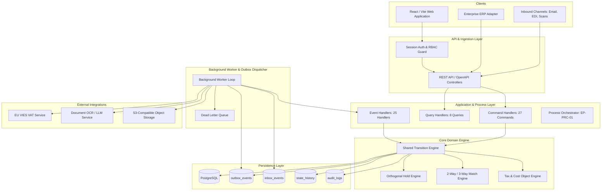

# Architecture Specification — Accounts Payable Automation Platform

## 1. Executive Summary & Architectural Paradigm

The AP Automation Platform is engineered as a high-integrity, modular monolith designed for ABC BV (Netherlands solar panel manufacturer). The platform automates inbound document intake, data extraction, trust verification, three-way matching, exception management, multi-tier approval routing, and ERP posting integration across 60 technical entry points and 69 domain scenarios.

### Architectural Principles
1. **Modular Monolith**: Clean layer boundaries (Domain, Application Services, Infrastructure, REST API, Background Worker) without premature microservice distributed complexity.
2. **Deterministic Domain Core**: Business rules, state transitions, and validation invariants execute purely deterministically. AI is encapsulated as an untrusted recommendation engine.
3. **Atomic Single-Transaction Commit**: Guards, state change, audit history write, and outbox event write occur in one atomic PostgreSQL transaction.
4. **Reliable Asynchronous Messaging**: Transactional Outbox pattern paired with a persistent Inbox deduplication table guarantees exactly-once processing semantics.
5. **Zero-Trust Input Processing**: Inbound documents and LLM extraction outputs are treated as untrusted and strictly validated against JSON schemas before domain ingestion.
6. **Orthogonal Hold Governance**: Invoice state machine transitions are strictly guarded by an orthogonal hold engine—no invoice advances while an active hold exists.

---

## 2. Layered Structure & Module Responsibilities

### 2.1 Domain Layer (`src/domain/`)
- Contains pure entities, value objects, domain invariants, and transition rules.
- Free of any database, HTTP, or framework dependencies.
- Sub-modules:
  - `document`: Inbound document entity and classification.
  - `invoice`: Invoice aggregate, line items, currency, VAT treatments.
  - `matching`: Matching rules (two-way PO, three-way Goods Receipt, contract, credit note).
  - `holds`: Hold types, severity, resolution logic.
  - `exception`: Exception entity, assignment, escalation timer rules.
  - `approval`: Approval tasks, delegation, split coding, authorization matrix.
  - `reference`: Vendor, PO, Goods Receipt, Contract read-models.

### 2.2 Application Layer (`src/application/`)
- Orchestrates domain objects, transactions, and infrastructure ports.
- Implements:
  - **Commands (27)**: Handles user and system commands, manages idempotency, optimistic locking checks (`expected_version`), and invokes the Transition Engine.
  - **Event Handlers (25)**: Consumes outbox events via persistent inbox deduplication.
  - **Queries (8)**: Fast read-models optimized for screens, aging reports, and audit trails.

### 2.3 Shared Transition Engine (`src/domain/transition/`)
- Centralized authority for state transitions (T01 through T14).
- Enforces universal invariants:
  - Verifies entity exists and matches `expected_version`.
  - Checks no blocking active holds exist.
  - Evaluates entry-point specific guards.
  - Updates target state.
  - Appends record to `state_history`.
  - Stages domain events to `outbox_events`.
  - Commits all mutations in a single PostgreSQL transaction.

### 2.4 Infrastructure Layer (`src/infrastructure/`)
- Database access via Drizzle ORM and PostgreSQL.
- S3 client for raw document attachments.
- External adapters with circuit breaker, retry/backoff, and fallbacks:
  - `ViesClient`: European Commission VAT validation.
  - `AiExtractionClient`: OCR and structured extraction with prompt/model tracking.
  - `ErpAdapter`: Asynchronous invoice posting interface.

### 2.5 API Layer (`src/api/`)
- Express/Node.js REST API exposing OpenAPI-compliant routes.
- Extracts authenticated actor from session token (never request payload).
- Performs schema validation and maps standard error codes.

---

## 3. Engineering Invariants & Conventions

1. **Session Actor Derivation**: The authenticated user/role is resolved strictly from the verified session context (`req.user`), never from request bodies.
2. **Idempotency**: All mutating commands accept `Idempotency-Key`. Re-sent requests within the idempotency window return the cached first response without side effects.
3. **Optimistic Locking**: State-mutating commands require `expected_version`. If the database row version differs, a `VERSION_CONFLICT` (409) is returned.
4. **Persistent Inbox**: Event handlers check `inbox_events` by `event_id`. Duplicate deliveries are safely acknowledged and skipped.
5. **Transactional Outbox**: Events are written directly into `outbox_events` inside the state change database transaction. The background worker publishes them reliably.
6. **Standardized Error Hierarchy**:
   - `VALIDATION` (400): Malformed input or schema failure.
   - `NOT_FOUND` (404): Target entity missing.
   - `FORBIDDEN` (403): Role, legal entity, or Segregation of Duties failure.
   - `GUARD_FAILED` (422): Business rule or state machine guard failure with explicit rule name.
   - `VERSION_CONFLICT` (409): Optimistic locking concurrency conflict.
