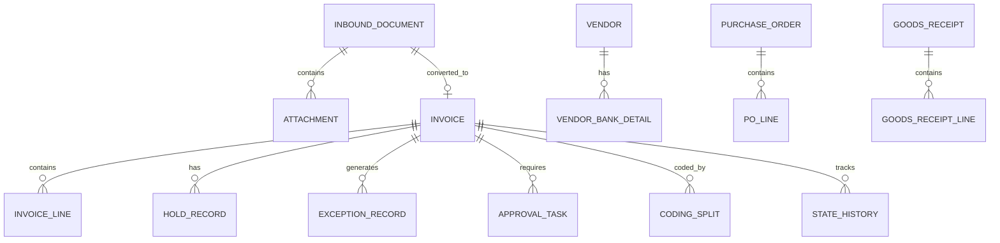

# Data Model & PostgreSQL Schema Specification

## 1. Overview & ORM Strategy

The data layer is implemented on PostgreSQL 15+ using Drizzle ORM. The schema cleanly separates inbound documents from commercial invoices, encapsulates holds orthogonally, and provides append-only audit and event tables.



---

## 2. Core Entities & Table Definitions

### 2.1 Inbound Documents & Attachments
```sql
-- Inbound Document (Pre-invoice raw submission)
CREATE TABLE inbound_documents (
    id UUID PRIMARY KEY DEFAULT gen_random_uuid(),
    fingerprint VARCHAR(64) NOT NULL, -- SHA-256 of primary payload
    channel VARCHAR(32) NOT NULL, -- email, portal_edi, paper, photo
    status VARCHAR(32) NOT NULL DEFAULT 'received', -- received, classified, duplicate, returned, filed, converted
    sender VARCHAR(255) NOT NULL,
    subject VARCHAR(255),
    received_at TIMESTAMPTZ NOT NULL DEFAULT NOW(),
    document_class VARCHAR(64), -- commercial_invoice, proforma, credit_note, delivery_note, statement
    classification_confidence NUMERIC(5,4),
    classification_method VARCHAR(32), -- rules, ai, person
    legal_entity_id VARCHAR(64), -- ABC BV entity
    duplicate_of_id UUID REFERENCES inbound_documents(id),
    converted_invoice_id UUID,
    physical_original_retained BOOLEAN DEFAULT FALSE,
    version INT NOT NULL DEFAULT 1,
    created_at TIMESTAMPTZ NOT NULL DEFAULT NOW(),
    updated_at TIMESTAMPTZ NOT NULL DEFAULT NOW()
);

-- File Attachments (Stored in S3)
CREATE TABLE attachments (
    id UUID PRIMARY KEY DEFAULT gen_random_uuid(),
    document_id UUID REFERENCES inbound_documents(id) ON DELETE CASCADE,
    storage_key VARCHAR(512) NOT NULL,
    file_name VARCHAR(255) NOT NULL,
    media_type VARCHAR(128) NOT NULL,
    byte_size BIGINT NOT NULL,
    sha256_hash VARCHAR(64) NOT NULL,
    is_primary BOOLEAN DEFAULT FALSE,
    created_at TIMESTAMPTZ NOT NULL DEFAULT NOW()
);
```

### 2.2 Commercial Invoices & Line Items
```sql
-- Commercial Invoice Entity
CREATE TABLE invoices (
    id UUID PRIMARY KEY DEFAULT gen_random_uuid(),
    document_id UUID REFERENCES inbound_documents(id),
    invoice_number VARCHAR(128) NOT NULL,
    vendor_id UUID NOT NULL,
    legal_entity_id VARCHAR(64) NOT NULL, -- ABC BV Entity (e.g. ABC_NL_01)
    status VARCHAR(32) NOT NULL DEFAULT 'Received', 
    -- Received, Captured, Screened, Eligible, Matched, Awaiting approval, Approved, Ready to post, Posted, Rejected, Superseded, Closed
    kind VARCHAR(32) NOT NULL DEFAULT 'standard', -- standard, credit_note, proforma, non_payable
    invoice_date DATE NOT NULL,
    due_date DATE,
    currency VARCHAR(3) NOT NULL DEFAULT 'EUR',
    net_amount NUMERIC(15,2) NOT NULL DEFAULT 0.00,
    tax_amount NUMERIC(15,2) NOT NULL DEFAULT 0.00,
    gross_amount NUMERIC(15,2) NOT NULL DEFAULT 0.00,
    vat_number VARCHAR(64),
    bank_iban VARCHAR(64),
    bank_bic VARCHAR(32),
    purchase_order_id UUID,
    contract_id UUID,
    is_urgent BOOLEAN NOT NULL DEFAULT FALSE,
    urgent_reason TEXT,
    terminal_reason VARCHAR(64), -- for rejected, superseded, closed
    superseded_by_id UUID REFERENCES invoices(id),
    rejection_reason VARCHAR(64),
    version INT NOT NULL DEFAULT 1,
    created_at TIMESTAMPTZ NOT NULL DEFAULT NOW(),
    updated_at TIMESTAMPTZ NOT NULL DEFAULT NOW(),
    CONSTRAINT uq_vendor_invoice_num UNIQUE(vendor_id, invoice_number)
);

-- Line Items
CREATE TABLE invoice_lines (
    id UUID PRIMARY KEY DEFAULT gen_random_uuid(),
    invoice_id UUID NOT NULL REFERENCES invoices(id) ON DELETE CASCADE,
    line_number INT NOT NULL,
    description TEXT NOT NULL,
    original_description TEXT, -- If translated from foreign language
    quantity NUMERIC(15,4) NOT NULL DEFAULT 1.0000,
    unit_price NUMERIC(15,4) NOT NULL DEFAULT 0.0000,
    net_amount NUMERIC(15,2) NOT NULL DEFAULT 0.00,
    tax_rate NUMERIC(5,4) NOT NULL DEFAULT 0.2100, -- 21% Dutch standard BTW
    tax_amount NUMERIC(15,2) NOT NULL DEFAULT 0.00,
    po_line_id UUID,
    match_status VARCHAR(32) NOT NULL DEFAULT 'unmatched', -- unmatched, matched, variance_accepted
    variance_amount NUMERIC(15,2) DEFAULT 0.00,
    variance_reason VARCHAR(64),
    created_at TIMESTAMPTZ NOT NULL DEFAULT NOW()
);
```

### 2.3 Orthogonal Holds & Exceptions
```sql
-- Holds (Orthogonal to Invoice Status)
CREATE TABLE hold_records (
    id UUID PRIMARY KEY DEFAULT gen_random_uuid(),
    invoice_id UUID NOT NULL REFERENCES invoices(id) ON DELETE CASCADE,
    invoice_line_id UUID REFERENCES invoice_lines(id),
    hold_type VARCHAR(64) NOT NULL, 
    -- CAPTURE_REVIEW, TRUST_REVIEW, DUPLICATE_REVIEW, VARIANCE_REVIEW, AWAITING_RECEIPT, BUDGET_REVIEW, DISPUTE_HOLD, POST_APPROVAL_REVIEW, MANUAL_HOLD
    status VARCHAR(32) NOT NULL DEFAULT 'active', -- active, released
    placed_by_actor_id VARCHAR(64) NOT NULL,
    placed_at TIMESTAMPTZ NOT NULL DEFAULT NOW(),
    release_reason TEXT,
    released_by_actor_id VARCHAR(64),
    released_at TIMESTAMPTZ
);

-- Exceptions & Human Intervention
CREATE TABLE exception_records (
    id UUID PRIMARY KEY DEFAULT gen_random_uuid(),
    invoice_id UUID NOT NULL REFERENCES invoices(id) ON DELETE CASCADE,
    hold_id UUID REFERENCES hold_records(id),
    exception_type VARCHAR(64) NOT NULL, -- PRICE_MISMATCH, QUANTITY_MISMATCH, MISSING_RECEIPT, TAX_MISMATCH, UNKNOWN_ORDER
    status VARCHAR(32) NOT NULL DEFAULT 'open', -- open, in_progress, waiting, resolved
    priority VARCHAR(16) NOT NULL DEFAULT 'normal', -- normal, urgent, escalated
    assigned_to_actor_id VARCHAR(64),
    due_at TIMESTAMPTZ NOT NULL,
    escalation_level INT NOT NULL DEFAULT 0,
    resolution_type VARCHAR(64), -- price_accepted, receipt_confirmed, credit_note_requested, invoice_rejected
    resolution_notes TEXT,
    created_at TIMESTAMPTZ NOT NULL DEFAULT NOW(),
    updated_at TIMESTAMPTZ NOT NULL DEFAULT NOW()
);
```

### 2.4 Approvals & Cost Object Coding
```sql
-- Coding Splits (GL Account and Cost Objects)
CREATE TABLE coding_splits (
    id UUID PRIMARY KEY DEFAULT gen_random_uuid(),
    invoice_id UUID NOT NULL REFERENCES invoices(id) ON DELETE CASCADE,
    gl_account VARCHAR(64) NOT NULL,
    cost_centre VARCHAR(64),
    project_code VARCHAR(64),
    amount NUMERIC(15,2) NOT NULL,
    percentage NUMERIC(5,2) NOT NULL,
    confidence NUMERIC(5,4), -- If AI proposed
    status VARCHAR(32) NOT NULL DEFAULT 'proposed', -- proposed, confirmed
    confirmed_by_actor_id VARCHAR(64),
    confirmed_at TIMESTAMPTZ
);

-- Approval Tasks
CREATE TABLE approval_tasks (
    id UUID PRIMARY KEY DEFAULT gen_random_uuid(),
    invoice_id UUID NOT NULL REFERENCES invoices(id) ON DELETE CASCADE,
    step_number INT NOT NULL DEFAULT 1,
    approver_role VARCHAR(64) NOT NULL, -- Budget Owner, Finance Director
    assigned_actor_id VARCHAR(64) NOT NULL,
    status VARCHAR(32) NOT NULL DEFAULT 'pending', -- pending, approved, rejected, reassigned
    decision_reason TEXT,
    decided_at TIMESTAMPTZ,
    delegated_from_actor_id VARCHAR(64),
    created_at TIMESTAMPTZ NOT NULL DEFAULT NOW()
);
```

### 2.5 Outbox, Inbox & Immutability Audit
```sql
-- Transactional Outbox
CREATE TABLE outbox_events (
    id UUID PRIMARY KEY DEFAULT gen_random_uuid(),
    event_id VARCHAR(128) NOT NULL UNIQUE,
    event_name VARCHAR(128) NOT NULL,
    aggregate_type VARCHAR(64) NOT NULL,
    aggregate_id VARCHAR(128) NOT NULL,
    payload JSONB NOT NULL,
    status VARCHAR(32) NOT NULL DEFAULT 'pending', -- pending, published, failed
    retry_count INT NOT NULL DEFAULT 0,
    last_error TEXT,
    created_at TIMESTAMPTZ NOT NULL DEFAULT NOW(),
    published_at TIMESTAMPTZ
);

-- Persistent Inbox (Event Deduplication)
CREATE TABLE inbox_events (
    event_id VARCHAR(128) PRIMARY KEY,
    handler_name VARCHAR(128) NOT NULL,
    processed_at TIMESTAMPTZ NOT NULL DEFAULT NOW()
);

-- State History
CREATE TABLE state_history (
    id UUID PRIMARY KEY DEFAULT gen_random_uuid(),
    entity_type VARCHAR(64) NOT NULL, -- inbound_document, invoice, exception, approval_task
    entity_id UUID NOT NULL,
    transition_id VARCHAR(32), -- T01, T02, T03...
    from_state VARCHAR(64) NOT NULL,
    to_state VARCHAR(64) NOT NULL,
    actor_id VARCHAR(64) NOT NULL,
    actor_role VARCHAR(64) NOT NULL,
    reason TEXT,
    metadata JSONB,
    created_at TIMESTAMPTZ NOT NULL DEFAULT NOW()
);
```
