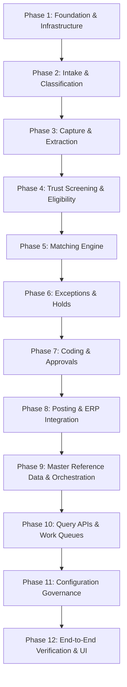

# Phased Implementation Roadmap & Status Register

## 1. Phased Dependency-Ordered Plan

To avoid unverified code generation and ensure structural consistency, the system is implemented across 12 dependency-ordered increments:

---

## 2. Phase Breakdown & Verification Gates

### Phase 1: Shared Foundation & Core Infrastructure
- **Deliverables**: Project setup, PostgreSQL schema via Drizzle ORM, Shared Transition Engine, Transactional Outbox & Persistent Inbox tables, Standard RFC 7807 Error hierarchy, Session Actor derivation.
- **Verification Gate**: Database migrations apply cleanly; atomic rollback and idempotency unit tests pass.

### Phase 2: Inbound Document Intake & Routing (`EP-INT-01` to `EP-INT-07`)
- **Deliverables**: Document registration, MIME validation, SHA-256 fingerprinting, classification rules & AI fallback, legal entity routing, return to sender, and filing non-invoices.
- **Verification Gate**: Scenarios 02.01, 02.02, 02.03, 02.04, 02.06, 02.07, 02.08, 02.10 pass acceptance tests.

### Phase 3: Invoice Conversion & Capture (`EP-INT-08`, `EP-CAP-01` to `EP-CAP-04`)
- **Deliverables**: Commercial invoice generation (T01), OCR extraction, header/lines math spot-check, capture validation (T02), manual field correction, and exact duplicate detection (T11).
- **Verification Gate**: Scenarios 03.01 to 03.07 pass acceptance tests.

### Phase 4: Screening & Eligibility (`EP-SCR-01` to `EP-SCR-02`, `EP-ELG-01` to `EP-ELG-03`)
- **Deliverables**: VIES VAT validation, bank detail screening, trust review holds, out-of-band verification logging, duplicate payment screening (T04), proforma handling (T14), and superseding (T13).
- **Verification Gate**: Scenarios 04.01 to 04.10, 05.01 to 05.08 pass acceptance tests.

### Phase 5: Matching Engine & Variances (`EP-MAT-01` to `EP-MAT-06`)
- **Deliverables**: Two-way PO matching, three-way Goods Receipt matching, non-PO contract matching, credit note linking, tolerance evaluation, line pairing confirmation, and variance acceptance (T05).
- **Verification Gate**: Scenarios 06.01 to 06.12, 10.05 pass acceptance tests.

### Phase 6: Exceptions & Holds Management (`EP-EXC-01` to `EP-EXC-09`)
- **Deliverables**: Place/release holds, exception creation, assignment, party contact logging, exception resolution, SLA timers, escalation chains, and commercial invoice rejection (T11).
- **Verification Gate**: Scenarios 07.01 to 07.07 pass acceptance tests.

### Phase 7: Coding & Approval Workflow (`EP-APR-01` to `EP-APR-08`)
- **Deliverables**: GL/Cost centre proposal, manual coding confirmation, submission for approval (T06), multi-tier approval decision (T07/T08), out-of-office delegation, urgent marking, and material change voiding (T12/T12b).
- **Verification Gate**: Scenarios 08.01 to 08.08 pass acceptance tests.

### Phase 8: Release for Posting & ERP Integration (`EP-PST-01` to `EP-PST-03`)
- **Deliverables**: Accounting period validation, release for posting (T09), mock ERP integration adapter, posting acknowledgement handler (T10), and posting refusal handler (T10b).
- **Verification Gate**: Scenarios 09.05, 11.01 pass acceptance tests.

### Phase 9: Master Reference Data & Orchestration (`EP-REF-01` to `EP-REF-07`, `EP-PRC-01`)
- **Deliverables**: Vendor bank changes, vendor block/deactivation events, PO change handlers, dispute change handlers, master data requests, and process auto-advance orchestrator.
- **Verification Gate**: Act 1 and Act 12 reference data scenarios pass acceptance tests.

### Phase 10: Query APIs & Work Queues (`EP-QRY-01` to `EP-QRY-08`)
- **Deliverables**: Role-scoped work queue, invoice detail view with audit trail, exceptions list, my approvals, AP aging report, search, and intake queue.
- **Verification Gate**: Fast read-model queries return correct role-filtered data.

### Phase 11: Configuration Governance & Dual Control (`EP-CFG-01`)
- **Deliverables**: Config area versioning (tolerances, confidence thresholds, SLA timers), strict author != approver dual-control enforcement.
- **Verification Gate**: Dual-control segregation of duties tests pass.

### Phase 12: End-to-End Scenarios Verification & UI
- **Deliverables**: Automated test suite executing all 69 v1 scenarios; responsive React/TypeScript frontend with work queues, approval modals, and audit views.
- **Verification Gate**: 100% of the 60 entry points verified and operational.
