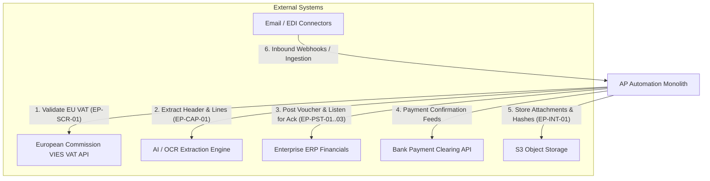

# External Integrations & Resilience Architecture

## 1. External Integration Boundaries

The AP platform integrates with six external systems across European compliance, AI extraction, and enterprise finance:

---

## 2. Integration Specifications

### 2.1 European Commission VIES VAT API (`EP-SCR-01`)
- **Purpose**: Verifies EU VAT identification numbers (e.g., Dutch `NL`, German `DE`, French `FR`) for cross-border reverse-charge eligibility.
- **Endpoint**: SOAP / REST EU VIES validation service.
- **Resilience Policy**:
  - **Timeout**: 5000 ms.
  - **Retries**: 3 retries with exponential backoff (`factor: 2`, initial delay `1000ms`, jitter `±200ms`).
  - **Fallback**: If VIES is temporarily unreachable, the system does **NOT** treat the check as a pass. Instead, it places a `TRUST_REVIEW` hold and schedules an automatic retry job.

### 2.2 AI / Document Extraction Engine (`EP-CAP-01`)
- **Purpose**: Extracts header data (invoice number, date, vendor, totals) and line items (descriptions, quantities, unit prices).
- **Security Policy**:
  - Raw document text is treated strictly as **untrusted data**.
  - Extraction output is parsed through a strict Zod / JSON Schema validator before persistence.
  - The exact LLM model ID, prompt template version, and per-field confidence scores are immutably logged with the extraction record.

### 2.3 ERP Posting Adapter (`EP-PST-01`, `EP-PST-02`, `EP-PST-03`)
- **Purpose**: Posts approved invoice vouchers into the core accounting ledger.
- **Interface Protocol**:
  - `EP-PST-01` writes an outbox message `ap.invoice.posting_requested.v1`.
  - The ERP adapter consumes the message and returns an asynchronous webhook:
    - **Acknowledgement**: `ap.invoice.posting_acknowledged.v1` (with `erp_voucher_id`), triggering `EP-PST-02` (T10: `Posted`).
    - **Refusal**: `ap.invoice.posting_refused.v1` (with refusal code, e.g., closed fiscal period), triggering `EP-PST-03` (T10b: reverts to `Approved`).

### 2.4 S3-Compatible Object Storage
- **Purpose**: Immutable document storage for uploaded PDFs, TIFF scans, and phone camera photos.
- **Integrity**: SHA-256 fingerprint generated prior to upload and stored in `attachments.sha256_hash`.

---

## 3. Resilience Standards (Conventions 7 & 8)

1. **No Failure Counts as a Pass**: If an external validation fails (e.g. VIES or Bank verification), the check fails or raises a hold. Silent fallbacks to 'success' are strictly prohibited.
2. **Circuit Breaking**: External clients implement standard 3-state circuit breakers (Closed -> Open on 5 consecutive failures -> Half-Open after 30s reset timeout).
3. **Dead-Letter Queue (DLQ)**: Outbox event deliveries failing after 5 retries are moved to `dead_letter_events` with alert notifications to the AP Controller.
