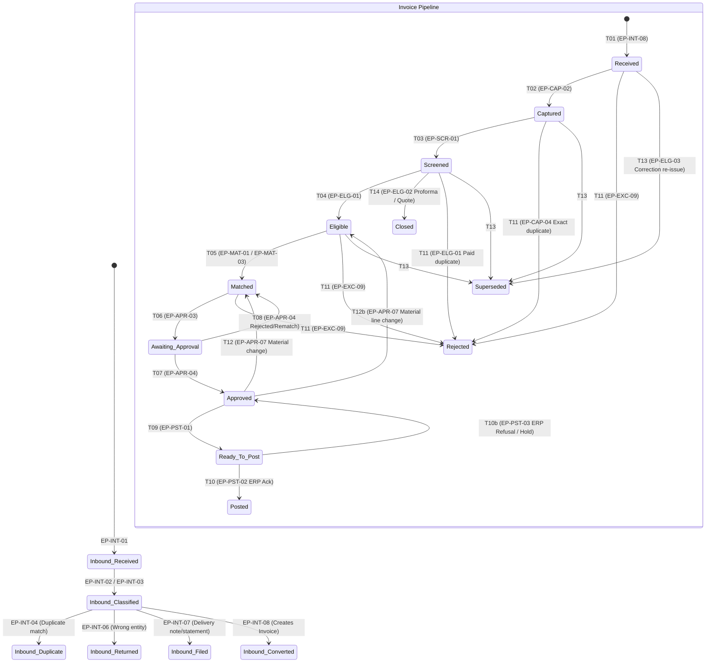
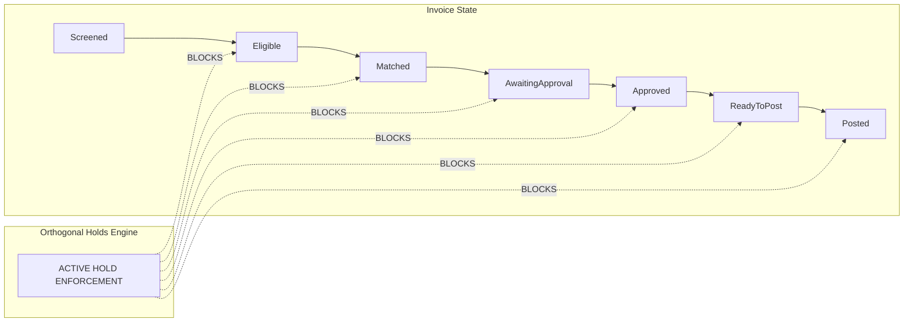

# State Machine & Business Logic Engine

## 1. Dual-Entity Lifecycle Architecture

The platform strictly avoids conflating inbound raw documents with commercial accounting invoices. Two formal state machines govern the intake and accounting pipelines.

---

## 2. Invoice Named Transitions Reference Table

| Transition ID | From State | To State | Triggering Entry Point | Mandatory Guards & Business Rules |
| :--- | :--- | :--- | :--- | :--- |
| **T01** | `(new)` | `Received` | `EP-INT-08` | Inbound document classified as commercial invoice, legal entity identified, not duplicate. |
| **T02** | `Received` | `Captured` | `EP-CAP-02` | Mandatory fields present; line items net amount sum equals header net amount; currency valid. |
| **T03** | `Captured` | `Screened` | `EP-SCR-01` | Vendor active; bank IBAN matches master file; VAT number passes VIES check; no trust review hold. |
| **T04** | `Screened` | `Eligible` | `EP-ELG-01` | No active duplicate invoice; vendor not in insolvency/stop-pay; active contract/PO found if required. |
| **T05** | `Eligible` | `Matched` | `EP-MAT-01`, `EP-MAT-03` | Price and quantity variances within configured tolerance thresholds, or explicitly accepted by Controller/Buyer. |
| **T06** | `Matched` | `Awaiting approval` | `EP-APR-03` | All lines assigned GL account and cost centre/project; approval tasks generated for cost centre owners. |
| **T07** | `Awaiting approval`| `Approved` | `EP-APR-04` | All required approvers (Tier 1 Budget Owner, Tier 2 Finance Director if > threshold) have approved. |
| **T08** | `Awaiting approval`| `Matched` | `EP-APR-04` | Approver rejects or requests re-evaluation; resets approval tasks for resubmission. |
| **T09** | `Approved` | `Ready to post` | `EP-PST-01` | Accounting period open; no active dispute or legal hold placed post-approval. |
| **T10** | `Ready to post` | `Posted` | `EP-PST-02` | ERP integration acknowledges successful posting with ERP voucher ID. |
| **T10b** | `Ready to post` | `Approved` | `EP-PST-03`, `EP-EXC-01`| ERP posting refused or active hold placed while waiting to post; halts release. |
| **T11** | `any non-terminal` | `Rejected` | `EP-CAP-04`, `EP-ELG-01`, `EP-EXC-09` | Exact duplicate, previously paid invoice, or formal commercial rejection by Controller. |
| **T12** | `Approved` / `Ready to post` | `Matched` | `EP-APR-07` | Material change in cost centre / coding occurs; voids approvals and requires re-approval. |
| **T12b**| `Approved` / `Ready to post` | `Eligible` | `EP-APR-07` | Material change in quantities, prices, or line amounts occurs; voids match and approvals. |
| **T13** | `any non-terminal` | `Superseded` | `EP-ELG-03` | Vendor issues corrected replacement invoice; old invoice marked superseded and linked both ways. |
| **T14** | `Screened` | `Closed` | `EP-ELG-02` | Proforma invoice decided as advance payment or quote only; closed without normal AP posting. |

---

## 3. Orthogonal Hold Governance Model

**Core Rule**: No forward transition may execute while any hold is active on an invoice or any of its lines.

### Active Hold Types and Blocking Logic
1. `CAPTURE_REVIEW`: Placed when OCR extraction confidence is low or totals disagree. Blocks T02.
2. `TRUST_REVIEW`: Placed when vendor bank details changed recently, personal email used, or out-of-band callback pending. Blocks T03.
3. `DUPLICATE_REVIEW`: Placed on suspected near-duplicate invoice. Blocks T04.
4. `VARIANCE_REVIEW`: Placed when price or quantity exceeds tolerance limit. Blocks T05.
5. `AWAITING_RECEIPT`: Placed when goods receipt note has not yet been logged in warehouse. Blocks T05.
6. `BUDGET_REVIEW`: Placed when cost-centre budget is exhausted. Blocks T06/T07.
7. `DISPUTE_HOLD`: Placed when commercial dispute or vendor claim is open. Blocks T09/T10.
8. `POST_APPROVAL_REVIEW`: Placed when material data changes occur prior to posting. Reverts via T10b.
9. `MANUAL_HOLD`: Placed by AP Controller for ad-hoc compliance or credit check. Blocks all forward steps.
