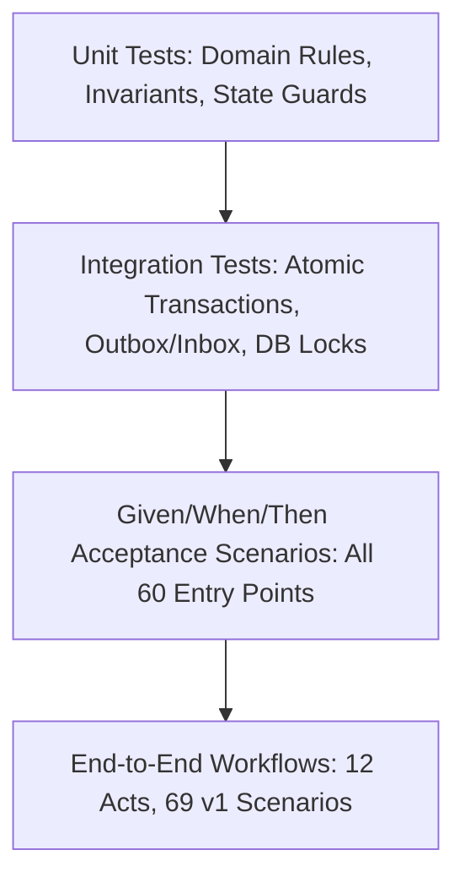

# Automated Verification & Test Strategy

## 1. Testing Philosophy & Framework

The platform follows a rigorous specification-driven test strategy using **Vitest** for unit and integration testing. Every entry point in the technical catalogue includes explicit Given/When/Then acceptance tests executed against a shared deterministic test fixture set.

---

## 2. Test Doubles & Deterministic Mocks

To guarantee fast, hermetic, and offline test execution, all external services are mocked deterministically:
1. **Mock VIES Service**: Configured with known test VAT numbers (e.g. `NL123456789B01` valid, `NL999999999B99` invalid, `TIMEOUT` simulates service failure).
2. **Mock AI Extraction Engine**: Returns predetermined schema-valid extraction payloads with configurable confidence scores.
3. **Mock ERP Adapter**: Simulates instant or delayed posting ACKs and refusals without live ERP connectivity.
4. **Mock S3 Client**: In-memory buffer storage with SHA-256 hashing.

---

## 3. Mandatory Invariant Test Matrix

The test suite explicitly asserts all 12 core architecture conventions:

| Test Category | Target Invariant | Assertion & Expected Behavior |
| :--- | :--- | :--- |
| **Idempotency** | Duplicate command submission | Submitting the same `Idempotency-Key` returns the exact initial result without duplicating side effects or database rows. |
| **Inbox Deduplication** | Duplicate event delivery | Sending an event with an already-processed `event_id` in `inbox_events` is silently ignored. |
| **Optimistic Concurrency**| Version collision | Submitting an update with an outdated `expected_version` triggers `409 VERSION_CONFLICT`. |
| **Atomic Rollback** | Guard failure in transaction | If a state transition guard fails, any accompanying state changes, history writes, or outbox events are rolled back. |
| **Hold Enforcement** | Active hold bypass attempt | Invoking any forward transition (e.g. `T04`, `T05`, `T06`, `T07`, `T09`) while an active hold exists triggers `422 GUARD_FAILED`. |
| **Segregation of Duties** | Author approves config | Submitting `EP-CFG-01` with `author_ref == approver_ref` triggers `403 FORBIDDEN (SAME_AUTHOR_APPROVER)`. |
| **Three-Way Matching** | Price & Quantity tolerances | Price variances within 2% pass automatically; variances above 2% place `VARIANCE_REVIEW` hold. |
| **Material Change Void** | Line amount edited after sign-off | Updating line items on an `Approved` invoice triggers `T12b` reverting to `Eligible` and voiding prior approvals. |
